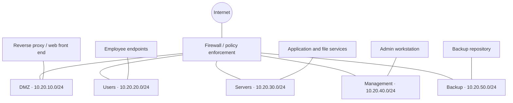

# Secure Infrastructure Lab
**Portfolio project · Network segmentation · Firewall policy design · Backup resilience**

> Educational design for a fictional small company. All names and IP ranges are examples. No production configuration or customer information is included.

## Objective
Design a segmented network for employee devices, public-facing services, application servers, management access and backup infrastructure. Use a firewall as the routing and policy enforcement point. This is a design project until you build and test the lab; do not claim unperformed tests as completed.

## Scenario
A fictional company has 40 workstations, an internal application and file service, a public-facing web service, identity/DNS/NTP services, a backup repository, and administrators who need controlled management access.

## Proposed topology

| Zone | Example subnet | Purpose |
|---|---|---|
| DMZ | `10.20.10.0/24` | Public-facing web/reverse proxy |
| Users | `10.20.20.0/24` | Employee endpoints |
| Servers | `10.20.30.0/24` | Applications and infrastructure services |
| Management | `10.20.40.0/24` | Restricted administrative workstation and interfaces |
| Backup | `10.20.50.0/24` | Backup server and repository |

These are illustrative RFC 1918 addresses; check for overlap with any existing lab.

## Security principles
1. Default deny between zones; permit documented business needs only.
2. Apply least privilege to source, destination, service and direction.
3. Keep administrative interfaces off user and DMZ networks.
4. Users and DMZ hosts cannot initiate sessions to the backup repository.
5. Publish only required services; never expose management interfaces directly to the Internet.
6. Log useful denied cross-zone traffic and important admin/backup events.
7. Document backup retention and perform restore tests.

## Implementation phases
### Phase 1 — Design
- [x] Define the fictional scenario and zones.
- [x] Draft policy matrix and validation tests.
- [ ] Finalize the diagram and record design decisions.

### Phase 2 — Build
- [ ] Choose a lab platform and firewall image you are licensed to use.
- [ ] Create isolated virtual networks for each zone.
- [ ] Add a test endpoint in each needed zone.
- [ ] Configure routing and firewall policy from the matrix.
- [ ] Save a sanitized configuration backup.

### Phase 3 — Validate
- [ ] Execute tests in `docs/validation-test-plan.md`.
- [ ] Save sanitized screenshots/logs.
- [ ] Fix unexpected access paths and repeat tests.

### Phase 4 — Publish
- [ ] Add dated test results and lessons learned.
- [ ] Link the project from the portfolio homepage.
- [ ] Remove credentials, tokens, personal data and employer/customer information.

## Limitations and future work
Segmentation reduces reachable paths; it does not itself stop phishing, credential theft, exploitation of allowed services or misuse of privileged accounts. Future work: outbound egress controls, DNS filtering, MFA for administrators, centralized logging, and documented RPO/RTO plus restore testing.

**Important:** Do not guess ports for backup software. Choose the product and use its official documentation before implementing rules. This fictional design is not a production-ready reference architecture.
